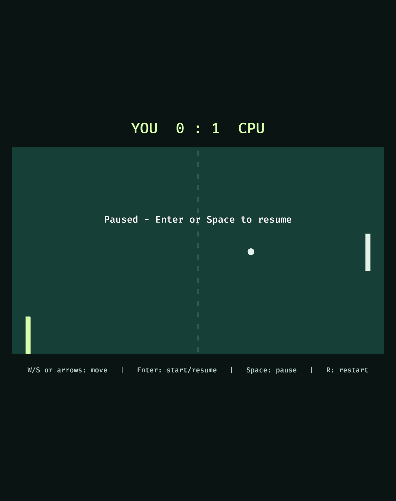
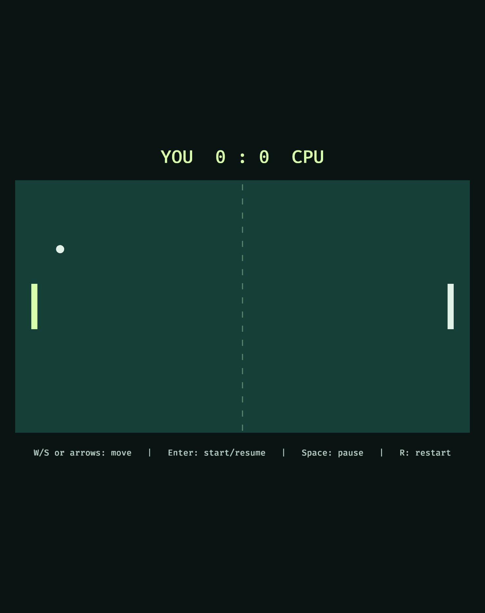

# Omarchy Bevy Mesh2d regression check

2026-11-12, source commit `55d0975`. This rechecks the Sprite-to-Mesh2d rectangle change introduced for Windows DX12; no further source changes were necessary.

- Omarchy ARM64, Apple M1 Pro (G13S C0), Honeykrisp Mesa 26.2.6-arch1.1, Vulkan selected automatically.
- Locked offline build and strict Clippy pass; 14 shared core/scenario tests pass.
- Bounded native `pong-bevy --scripted-test --scripted-captures /absolute/new-directory` exits 0, produces six supported application-owned framebuffer PNGs and thirteen telemetry records identical to the Macroquad baseline through tick 1440.
- Paused (480) and restarted (1440) images inspected: complete court, center dashes, both rectangular paddles and round ball visible. Scores 0:1 and 0:0 match the expected states. The Windows rendering fix has not introduced the reported missing-rectangle problem on this Linux GPU/backend.

This is scripted input and app-owned rendering evidence, not OS-input, compositor, focus, resize, latency, smoothness or full-match QA. Mac revalidation remains separate.

[Telemetry](evidence/omarchy-bevy-mesh-20261112.jsonl) · [All six PNG hashes and dimensions](evidence/omarchy-bevy-mesh-20261112.json)

