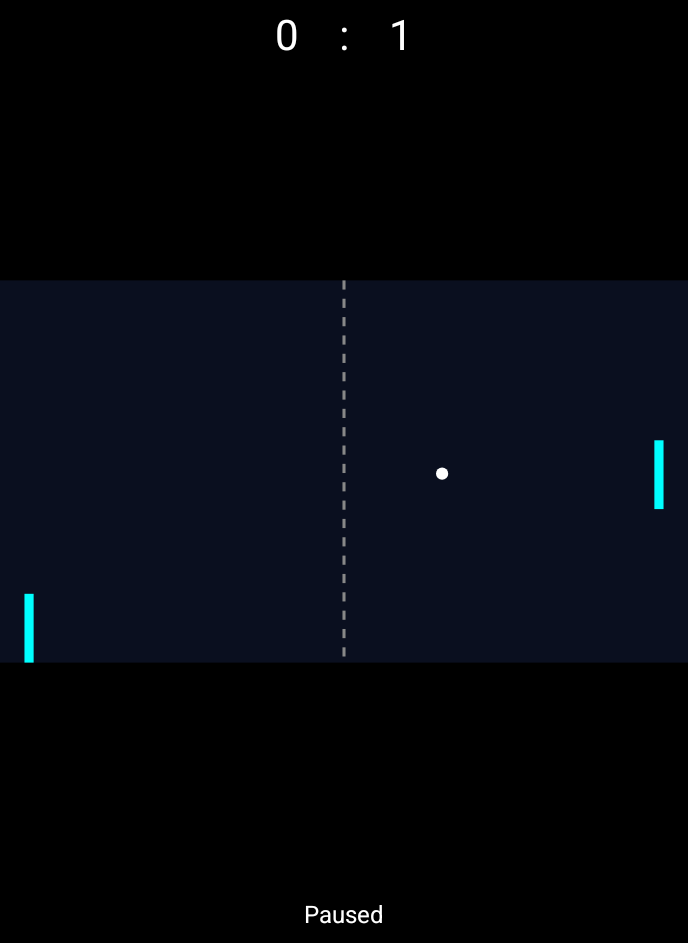
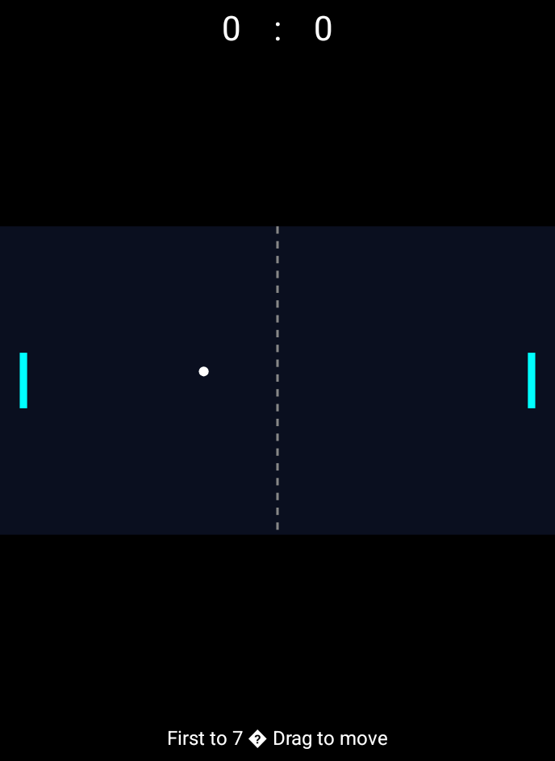

# Android app-owned scripted replay

Debug builds accept an explicit Activity intent extra `pong_scripted=true`.
Release builds ignore it. Ordinary launches keep existing touch/button controls.

The app reads the packaged canonical manifest, advances one deterministic logical
tick per visible frame, and renders with the same Canvas drawing function as normal
play. It records JSONL and six PNG checkpoints in a new UUID directory under app
private `files/replays/`. Captures include only this app's game view, not the OS,
other applications, title or buttons. Normal controls are disabled during replay.
Backgrounding suspends replay drawing; finishing stops the animation loop.

```powershell
adb -s emulator-5554 install -r app/build/outputs/apk/debug/app-debug.apk
adb -s emulator-5554 shell am start -S -n com.intrepion.pong.nativekotlin/.MainActivity --ez pong_scripted true
adb -s emulator-5554 shell run-as com.intrepion.pong.nativekotlin ls files/replays
```

Read the resulting app-owned files through the debug app's `run-as` access. Each
completed directory contains `complete.json`, `telemetry.jsonl` and checkpoint
PNGs. These are renderer/replay evidence, not physical touch/focus validation.
No test deletes prior runs or changes emulator security/data.

## Verification (2026-11-12 UTC)

Source a27f120: Windows Gradle build and all 11 JVM tests passed. The existing
Android15/API35 emulator initially lacked its package service and remained at the
boot logo. Graceful shutdown/relaunch of the same AVD (no wipe) restored service.
APK install succeeded, and the explicit scripted intent completed 1,440 ticks,
13 telemetry rows and six PNG captures. `complete.json` reported tick1440/count6.
Pause and reset captures were inspected: court, paddles, ball, score and pause
label are correct. Portrait layout remains sparse; the existing instruction
separator renders as a replacement glyph. This is not a full UI polish pass.

[Telemetry](evidence/windows-kotlin-replay-20261112-telemetry.jsonl)





Only the test app was stopped afterward; emulator/data/artifacts were retained.
No new physical touch, focus/background, full manually played match or device
coverage is inferred. These images are app game-view Canvas captures, not full
emulator-screen captures. Normal-mode controls require a post-change regression
check; their earlier results remain historical rather than newly certified.
