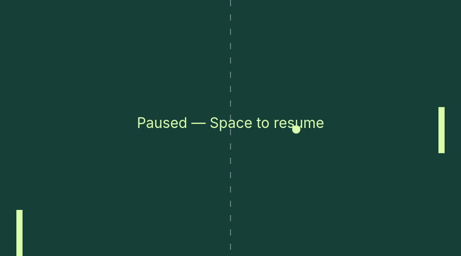
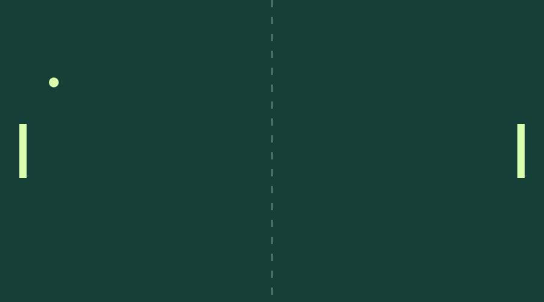

# Native Tauri scripted demo and own-canvas exports

Build the existing frontend WASM module first, then the native shell:

```sh
sh scripts/build-wasm.sh
cargo run --locked -p pong-tauri -- --scripted-test --scripted-captures /absolute/new-tauri-evidence
```

This retains the existing embedded `clients/web-wasm` frontend, its Rust/WASM shared Scenario, and its ordinary Canvas2D drawing. There is no duplicate input timeline. An opt-in Tauri page-load hook navigates local content to `?scripted-test`, waits for the app's completed `window.pongDemo`, and submits that evidence through a single scoped native command. The native side checks all thirteen reports against the same Rust Scenario, checks six expected capture ticks and PNG data-URL/signature format, and writes fixed filenames only within the new CLI-selected directory. Files use create-new semantics; existing evidence is not overwritten. Input evidence is limited to 8 MiB. Normal play rejects the command and has no output directory or completion hook. No general file-write API, remote-origin permissions or plugin capabilities are added.

The shell exits after saving six PNGs plus `telemetry.jsonl`. Without `--scripted-captures`, it reports validated telemetry to stdout and exits without files. Desktop evidence below does not claim Android/iOS support for these CLI arguments.

## Evidence boundary

These are exports of the actual app-owned Canvas2D court bitmap, not full webview screenshots. DOM score/status/buttons, window decorations, compositor presentation, real input/focus/resize, smoothness and full-match behavior are not verified by them. No OS screenshot or input workaround is used. The existing pause overlay partially overlaps the ball at tick 480; this is documented, not hidden. Frontend source was not changed in this native integration.

## Omarchy ARM64, 2026-11-12

- WebKitGTK 2.54.2; native build and strict all-target Clippy pass.
- Two native evidence-validation tests and fifteen shared core/scenario/WASM tests pass.
- Bounded native run exits 0 with six 900x500 PNGs and thirteen semantically identical baseline states through tick 1440. JSON object key order differs, so byte identity is not claimed.
- Pause/reset PNGs inspected: complete court, both paddles, center dashes and ball visible; pause overlay overlap noted above. Score lives outside the canvas and is confirmed only in telemetry.

[State evidence](evidence/omarchy-tauri-scripted-20261112.jsonl) · [Hashes and summary](evidence/omarchy-tauri-scripted-20261112.json)




