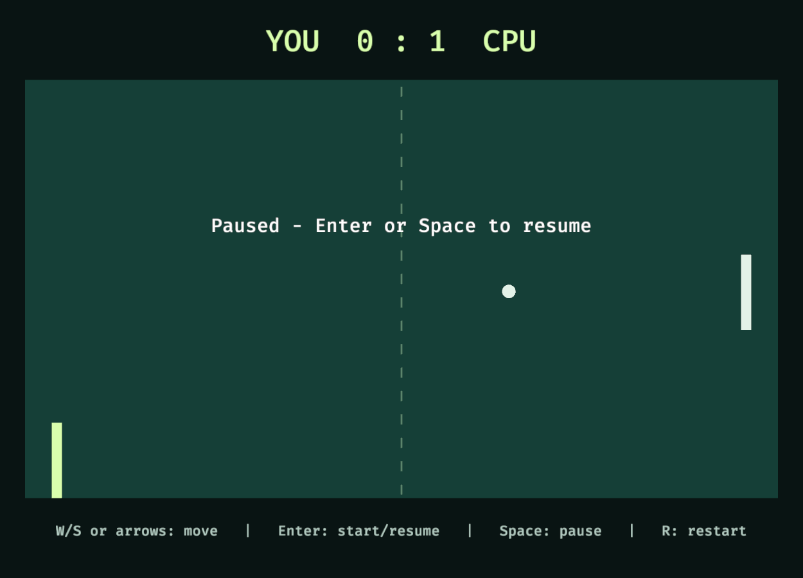
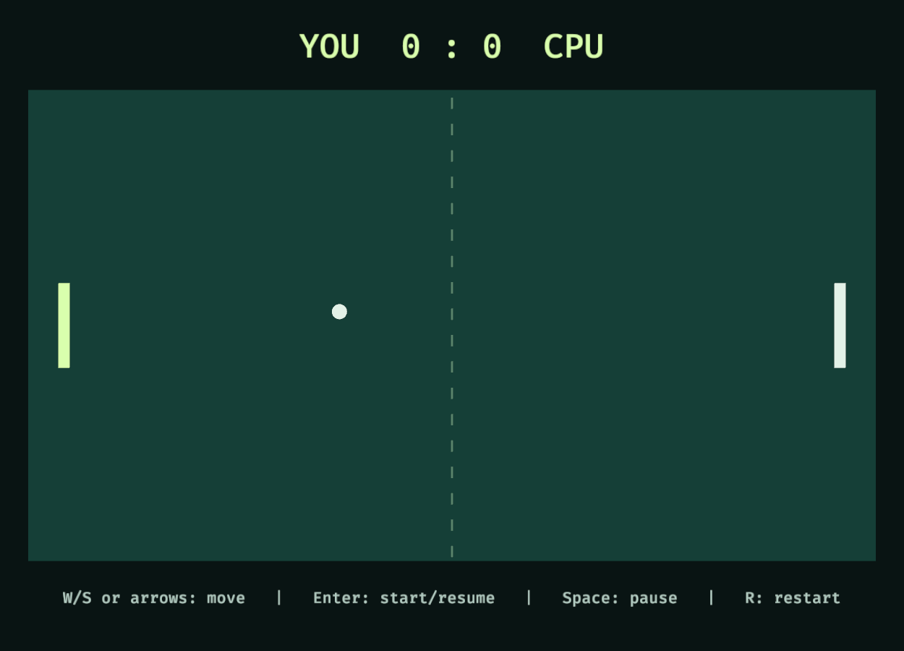

# Windows Bevy rendering diagnosis (2026-11-12 UTC)

Host: DESKTOP-HEL7V0H, Intel UHD Graphics 630, driver 31.0.101.2145.
Bevy 0.20.1 / wgpu 30.0.1, stable Windows MSVC toolchain.

## Reproduced before change

- Locked `cargo build -p pong-bevy -j2` passed.
- Default Vulkan scripted launch exited `-1073740940` before completing captures. The log also reports a missing Epic EOS overlay JSON; causality is **not established**. No driver, overlay, security or system settings were changed.
- Explicit DX12 scripted launch exited 0 and saved six PNG checkpoints, but the court was shifted and paddles were tiny. Text and the existing mesh ball were correctly rendered.

## Scoped presentation fix

Replace the court, centerline and paddle Sprites with Mesh2d rectangles and ColorMaterial. Dimensions, transforms, shared simulation and input handling are unchanged. This avoids the failing sprite path on this tested adapter; it does not establish the upstream root cause or fix Vulkan.

Shared regression checks passed (9 pong-core tests and 5 pong-scenario integration tests). A post-patch default/Vulkan retry still crashed, this time with access violation `-1073741819`; automatic backend selection is not fixed.

After rebuilding, explicit DX12 replay completed 1,440 ticks, exited 0 and saved all six captures. Pause (tick 480) and reset (tick 1320) were visually inspected: the court and paddles now have correct positions and dimensions. Telemetry reports pause, resume, scoring and reset. This is app-owned scripted validation, **not** proof of native keyboard input, focus loss, full-match play or smooth animation.





## Reproduce the supported workaround

In PowerShell, from the repository root (use a new output directory):

```powershell
$env:WGPU_BACKEND = 'dx12'
cargo run --locked -p pong-bevy -- --scripted-test --scripted-captures ./bevy-dx12-captures
Remove-Item Env:WGPU_BACKEND
```

Omit the two scripted arguments for normal interactive play. The environment variable applies only to this shell and child processes. The app's automatic backend selection remains unchanged; default Vulkan is still a known failure on this Windows host. The Mesh2d presentation change needs Mac/Omarchy revalidation. No claim is made that all Windows GPUs need DX12.


## Native DX12 follow-up

After the scripted run, a normal native window was checked through supported Computer Use: Enter started play; ball and CPU movement and score changes were visible; Space paused and resumed; maximizing retained the correct aspect and complete court; R reset the score; the Close button exited. Sustained player-key input, focus loss and a full match were not checked. This supersedes the pre-patch Windows DX12 visual-failure result only, not the Vulkan failure.

