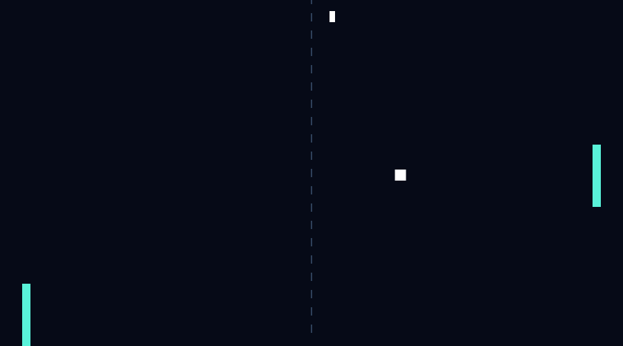

# Windows Miniquad recheck (2026-11-12 UTC)

Fresh MSVC build from checkpoint 5c7b887:

- Locked adapter test: 1 passed; locked debug build passed.
- App-owned scripted replay: 1,440 ticks, exit 0, all six PNG checkpoints saved. Pause sample inspected: court, paddles, ball and score pip correctly placed. The font-free renderer has no pause label; telemetry establishes the paused phase.
- Normal native launch: clean Ready court. Supported Computer Use Return did not start visible play. Clicking the court for focus, then Space, also left the ball centered. Test window closed and disappearance verified.

The earlier native-input limitation reproduces with a fresh MSVC binary, not only the old GNU snapshot. Physical-keyboard behavior remains unverified. Miniquad 0.4.11 translates the Windows WM_KEYDOWN scan-code field; automation compatibility is a hypothesis, not an established cause. No alternate input-injection mechanism or dependency input patch was used.

Scripted replay is not a native-input pass. Full matches, held-key movement/release, focus and minimize checks remain outstanding. Evidence was recovered after the Windows connection returned; it records the pre-disconnect run, not a fresh run against later source revisions.
