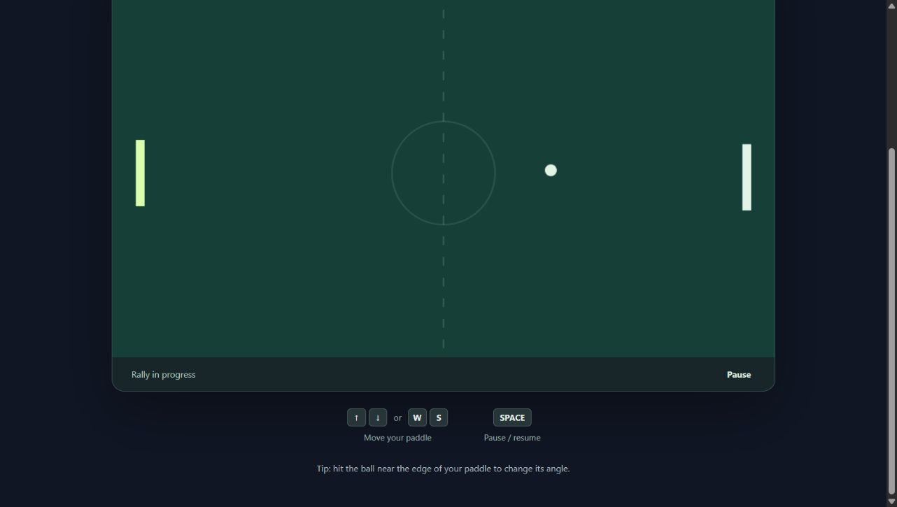

# Original browser game: TypeScript and regression verification

2026-11-12, Windows checkpoint. Not a main-branch deployment or full cross-platform certification.

## Source and build

`game.ts` is the strict TypeScript source for the original Canvas game. `game.js` is a committed generated artifact so existing static hosting continues to work. `npm ci && npm test` compiles using pinned TypeScript 5.9.3 and runs the simulation/controller tests. An optional [CI recipe](original-game-ci.example.yml) also checks for a stale generated artifact. It is documented, not installed: the existing GitHub OAuth permission does not include workflow updates. Locally, verify generated freshness after building with `git diff --exit-code -- game.js`. No runtime framework or runtime dependency was added. UI, controls, scoring, paddle geometry and AI tuning were preserved.

## Reproduced defects and fixes

| Defect in original JavaScript | Evidence before fix | Correction and regression coverage |
| --- | --- | --- |
| Same-direction touch + keyboard doubles paddle speed | 16 ms step: input 1 moves 7.52 px, input 2 moves 15.04 px | Clamp input to [-1,1], like Rust core; test both directions |
| Low-frame-rate slowdown | Horizontal ball after 1 real second: x=800 at 60 Hz vs x=681 at 20 Hz | RAF accumulator at 120 Hz, like Rust web adapters; test 20/60/120 Hz all reach x=800 |
| Nonfinite values poison simulation | NaN time/input corrupts paddle/ball state | Reject nonfinite values, like Rust core; test NaN and both infinities |

Nonfinite input is defensive hardening, not a reproduced normal browser interaction. Rust core itself retains the 33 ms per-step safety clamp; its web adapters supplied the fixed-step loop pattern. The original now retains its per-step clamp too, but uses 8.33 ms steps during normal browser execution.

Catch-up is deliberately bounded to 100 ms per frame, not unlimited real-time catch-up after a stall. Tests cover a five-second stall, reset discarding fractional accumulation/pause time, invalid timestamps, and the original six gameplay checks. All **12 tests pass**, with each of the three defect tests observed failing before implementation.

## Local browser smoke

Served with Node at `http://127.0.0.1:4189/`; no file URLs. Windows Chrome rendered the unchanged Rallylight court, Start entered the serve/rally, Pause showed the paused overlay, and Resume returned to play. This is a bounded UI smoke, not full touch/keyboard, seven-point, or cross-platform acceptance. Timing and combined-control edge cases above were verified deterministically at the simulation/controller seams, not by a browser FPS throttle.

Mac/Omarchy UI checks for this new build remain unverified. Hosted main is unchanged until separately promoted.

